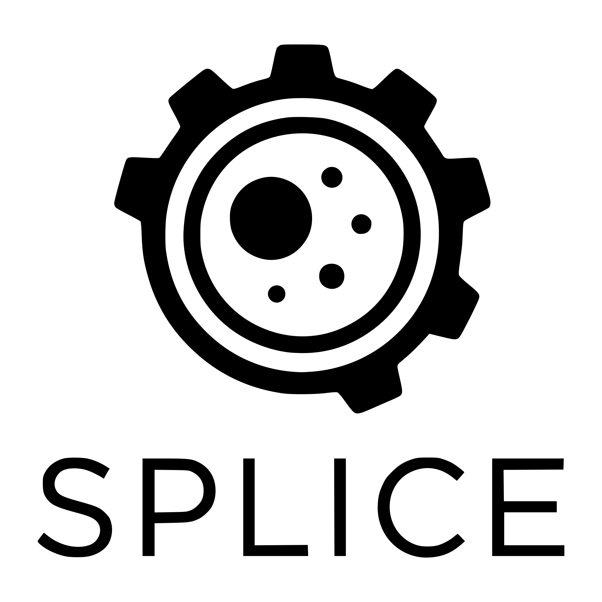

<div align="center">
  <picture>
    <source media="(prefers-color-scheme: light)" srcset="assets/splice_logo_acronym_black.png">
    <source media="(prefers-color-scheme: dark)" srcset="assets/splice_logo_acronym_white.png">
    
  </picture>

# nf-SPLICE

Prepare Nextflow pipelines for the SPLICE platform.

</div>

nf-splice reads a Nextflow pipeline repository, helps you review what it
finds, and publishes a validated **SPLICE workflow bundle**: a small set of
files in `splice/` that tells the platform what the pipeline is, which inputs
it accepts, which outputs it produces, which software it needs and how to run
it.

**Agentic AI is built in.** An agent can do the integration work for you:
read your Nextflow code, trace where every output is published, fill in and
check each part of the bundle, and build it, using nf-splice's own validated
operations. Work with it stage by stage, approving each change, or let it run
unattended within a scope you approve. Or do it all yourself: AI is optional.

## Three ways to work

| | You | The agent |
| --- | --- | --- |
| **Manual** | Review each step in the wizard or with commands | Answers questions (*Ask AI*); never changes anything |
| **AI-assisted** | Approve, question or object to each proposal | Proposes each stage with its diff and validation, then waits |
| **Autonomous** | Approve the scope once, read the report | Does the whole integration and reports what is done or blocked |

You can switch between them at any point; the work done so far is kept.

## Features

- **Agentic integration.** AI-assisted sessions and autonomous runs drive the
  same operations you would use, with every change validated by nf-splice,
  bounded permissions, checkpoints and a full audit trail.
- **Every output route.** nf-splice traces Nextflow publication rules across
  alternative and optional routes, so the output catalogue covers what the
  pipeline *may* publish, not only what one run produced.
- **Nothing is guessed.** Values found in your repository are suggestions
  until confirmed; open questions are listed until resolved; a model's word
  is never treated as validation.
- **Safe publishing.** Only valid bundles are published, existing files are
  never replaced silently, and an interrupted publication can be recovered.
- **Standard formats.** Five versioned JSON contracts based on JSON Schema,
  plus an RO-Crate, documented key by key for tool developers.
- **Works offline.** Without AI, no network, Nextflow installation or AI
  account is needed.

## Install

Requires Python 3.10 to 3.14, Git, and read access to this repository.
nf-splice is installed from GitHub; it is not published on PyPI.

```bash
python -m pip install "git+https://github.com/Beatson-CompBio/nf-SPLICE.git"
nf-splice --version
```

To try a branch before it is merged, add `@<branch>` to the address, for
example `...nf-SPLICE.git@wip/nf-splice-v0.3.0`. Agentic AI works with
Claude, OpenAI (including your ChatGPT Plus or Pro plan), Codex and OpenCode
(including local models); see [Agentic AI](docs/guide/agentic-ai.md) and
[AI providers and accounts](docs/guide/providers.md).

## Quick start

From the root of your pipeline repository, `init` writes six editable drafts
already filled with what the repository supports. Edit them in any editor
(or the wizard) and build:

```bash
nf-splice init
code .splice-local/drafts/          # or: nf-splice tui
nf-splice draft validate outputs
nf-splice build all && nf-splice validate
```

or let an agent investigate the pipeline and propose each stage's revision
for your approval:

```bash
nf-splice --actor "Your Name" session start --mode assisted --provider claude --allow-remote-model
```

or let it do the whole integration unattended and report back:

```bash
nf-splice --actor "Your Name" session start --mode autonomous --provider claude --allow-remote-model --example-output ../results
```

Follow the [Getting started guide](docs/guide/getting-started.md) for the
full walkthrough.

## Documentation

| | |
| --- | --- |
| [User guide](docs/USAGE.md) | Everything you need to publish and maintain a bundle |
| [Agentic AI](docs/guide/agentic-ai.md) | Ask AI, AI-assisted sessions and autonomous integration |
| [Command reference](docs/reference/cli.md) | Every command and option |
| [Assay capabilities](docs/guide/assays.md) | Declare which assays a pipeline processes, classified by the SPLICE modality vocabulary |
| [Building on SPLICE bundles](docs/CONTRACTS.md) | File formats for platform and tool developers |
| [Bundle consumer kit](bundle-consumer-kit/README.md) | Agent and skill files for developers building on bundles (ingestion, web UI, data explorers, job launchers), without nf-splice |
| [Schema reference](docs/schemas/README.md) | Every key of every file |
| [Glossary](docs/GLOSSARY.md) | Precise terms: bundle, job, sample, run |

## Privacy

nf-splice never publishes your Git e-mail address, never writes accounts,
credentials or private paths into a bundle, and never contacts the network
or an AI service unless you ask it to. Agent sessions stay in your
repository's private, Git-ignored `.splice-local/` folder. See
[Attribution and privacy](docs/guide/provenance.md#attribution-and-privacy).

## Contributing

See [CONTRIBUTING.md](CONTRIBUTING.md) and, for coding agents,
[AGENTS.md](AGENTS.md).

## Licence

MIT; see [`LICENSE`](LICENSE).
